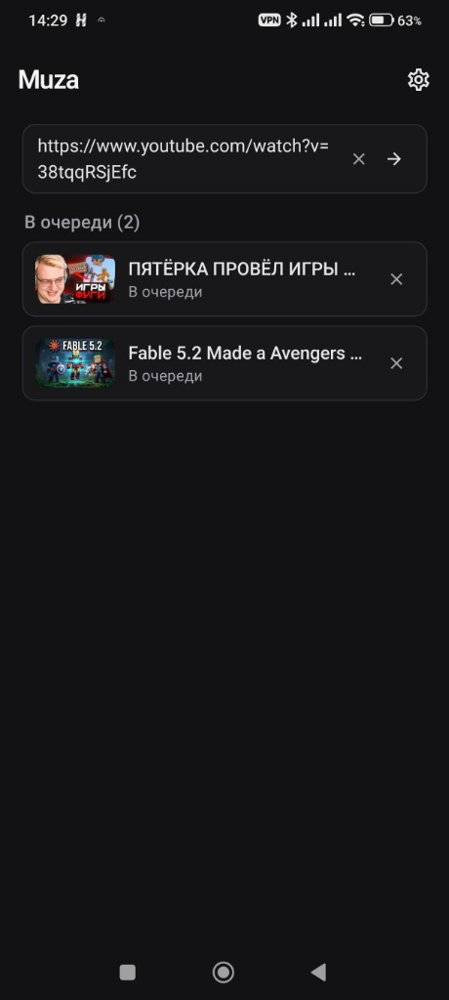
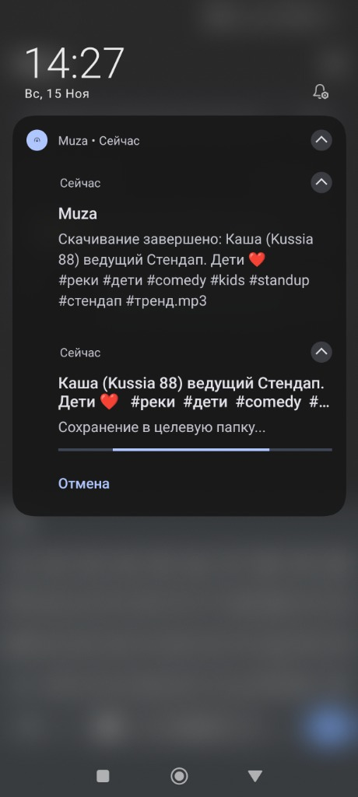

  

<h1 align="center">Muza</h1>

  Легкий и удобный инструмент для скачивания музыки и аудиодорожек с YouTube в формате MP3.

Проект доступен в двух версиях:
1. **Нативное Android-приложение** с очередью загрузок и интеграцией с меню «Поделиться».
2. **Браузерное расширение + Desktop Host (Windows)** для скачивания трека в 1 клик прямо со страницы видео без необходимости копировать ссылку.

Интерфейс обеих версий выполнен в спокойном монохромном стиле утилитарного минимализма.

---

## 1. Muza для Android

### Скриншоты

  
  &nbsp;&nbsp;&nbsp;&nbsp;
  

### Основные возможности
- **Выбор битрейта:** Сохранение аудио в MP3 с качеством от 128 до 320 kbps.
- **Очередь загрузок:** Добавляйте сразу несколько ссылок подряд. Приложение подгрузит обложки и скачает треки по очереди.
- **Интеграция с меню «Поделиться»:** Нажмите «Поделиться» под видео в YouTube или браузере и выберите Muza — ссылка сразу добавится в очередь.
- **Фоновая работа:** Прогресс отображается в шторке уведомлений, приложение можно сворачивать.
- **Сохранение в свою папку:** Выберите директорию через системный проводник (SAF).
- **Вход в аккаунт:** Поддержка авторизации для скачивания приватных треков и видео с возрастными ограничениями.

### Стек технологий (Android)
- **Язык и UI:** Kotlin, Jetpack Compose, Material 3
- **Движок:** yt-dlp (через youtubedl-android) и FFmpeg
- **Асинхронность:** Kotlin Coroutines и StateFlow

### Установка на Android
- Скачайте готовый `Muza-v1.0.0.apk` из раздела [Релизы (Releases)](https://github.com/YNGVLD11/Muza/releases/latest) и установите на смартфон.

---

## 2. Muza для Windows (Браузерное расширение + Хост)

Десктопная версия состоит из двух компонентов: легковесного браузерного расширения и локального фонового хоста на Python.

### Возможности
- **Скачивание в 1 клик:** При открытии расширения на странице YouTube оно само определяет видео, показывает название с обложкой и кнопку скачивания.
- **Плавный прогресс-бар:** В окне расширения в реальном времени отображается процент скачивания и этап конвертации в MP3.
- **Открыть в папке:** По окончании загрузки кнопка меняется на «Открыть в папке», вызывая проводник Windows с выделением скачанного файла.
- **Настройки:** Смена папки сохранения (по умолчанию `Загрузки`) через стандартный диалог Windows и выбор качества аудио.

### Стек технологий (Desktop)
- **Расширение:** Manifest V3, HTML5, CSS3, Vanilla JS
- **Хост:** Python, FastAPI, Uvicorn, yt-dlp, FFmpeg

### Установка и запуск на компьютере

1. **Регистрация хоста (один раз):**
   - Перейдите в папку `host-windows` (или скачайте `Muza-Host-Windows.zip` из релизов).
   - Запустите `install.bat`. Хост автоматически привяжется к браузерам (Chrome, Edge, Brave, Chromium) через безопасный протокол Chrome Native Messaging. Никаких фоновых окон или открытых портов держать не требуется.

2. **Установка расширения в браузер (Chrome / Edge / Brave / Yandex):**
   - Откройте в браузере страницу управления расширениями: `chrome://extensions/`
   - Включите переключатель **«Режим разработчика»** (Developer mode) в правом верхнем углу.
   - Нажмите **«Загрузить распакованное расширение»** (Load unpacked) и выберите папку `extension` (или распакованный `Muza-Extension-v1.0.0.zip`).
   - Иконка Muza появится на панели браузера.

---

## Лицензия

Проект распространяется под открытой лицензией Apache License 2.0.
